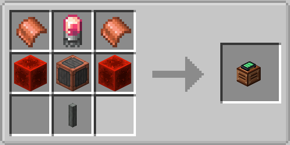
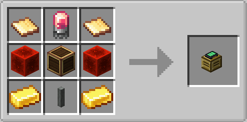
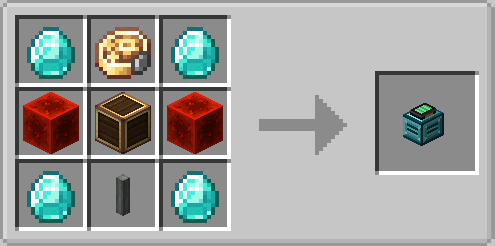
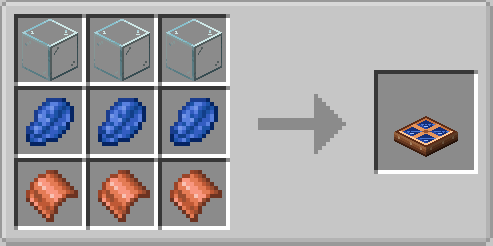
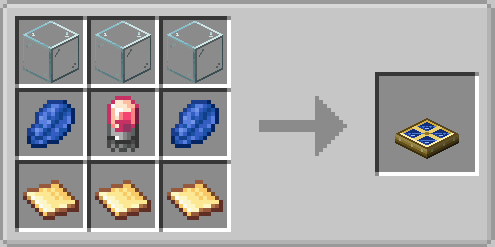
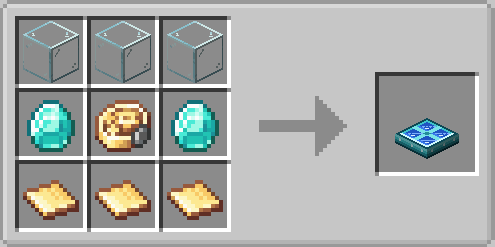
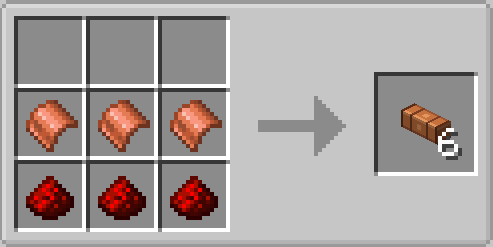

# Create: Pocket Dynamo

**Rotational Force you can put in your pocket.**

[Create](https://github.com/Creators-of-Create/Create) normally ties its power to a spot: a water wheel needs a river,
a steam engine needs a boiler, a belt of motors needs a cable of shafts. Pocket Dynamo adds a **battery-powered motor
you carry with you**. Charge it, set the speed, plug it into whatever contraption you are building, and when you are
done, wrench it back into your inventory. It remembers its charge and its speed.

Three tiers of motors, three tiers of solar panels to keep them fed, and an energy cable to bring the power from a
field of panels to wherever you work.

> **Status: beta (0.1.0-beta.1).** Everything works and is covered by automated tests, but the
> textures, the models and the logo are first drafts and block ids may still change before 1.0. Feedback is very welcome.

## How it plays

1. **Charge it.** A motor has an internal battery that fills with Forge Energy (FE) from any block placed next to it.
   A solar panel right beside the motor is enough.
2. **Put it to work.** Place the motor, open its value panel and choose the speed and direction, exactly like Create's
   Creative Motor, up to the limit of its tier. It now drives anything attached to it.
3. **Take it with you.** Sneak and use a Create Wrench on it. The motor goes to your inventory **with its charge and
   its selected speed**, and the item shows a charge bar. Place it somewhere else and it carries on.

When the battery runs dry the motor stops. It starts again by itself, with a small spark and a start-up sound, as soon
as it gets energy.

## What it adds

### Portable Motors

A kinetic generator with a battery. It turns stored FE into Rotational Force.

| Tier | Max speed | Stress capacity | Battery | Charges at up to | Speed cost |
|---|---|---|---|---|---|
| Copper | 32 RPM | 16,384 SU | 200,000 FE | 1,000 FE/t | 0.30 FE/t per RPM |
| Brass | 64 RPM | 49,152 SU | 400,000 FE | 2,000 FE/t | 0.25 FE/t per RPM |
| Diamond | 256 RPM | 262,144 SU | 2,000,000 FE | 8,000 FE/t | 0.20 FE/t per RPM |

Stress capacity is the total at maximum speed (SU per RPM times RPM); the motor offers less when you run it slower.

**What the energy is spent on.** While it spins, a motor pays a cost for every RPM it is set to, **even with nothing
connected**, plus a cost proportional to the stress its share of the network carries. Running faster costs more, so
set it only as fast as you need. Put on Create's Engineer's Goggles to read the battery and the current drain.

With nothing attached, a full battery lasts roughly 17 minutes (copper at 32 RPM), 21 minutes (brass at 64 RPM) or
33 minutes (diamond at 256 RPM). Any load shortens that.

### Solar Panels

Generate FE from sunlight and push it into the cables, motors and batteries next to them.

| Tier | Output at full sun | Buffer |
|---|---|---|
| Copper | 20 FE/t | 2,000 FE |
| Brass | 60 FE/t | 6,000 FE |
| Diamond | 180 FE/t | 18,000 FE |

- They need **open sky above them** and a dimension that has skylight, such as the Overworld.
- Output follows the daylight: full at noon, roughly a quarter at midnight, with dawn and dusk in between.
- **Rain and storms cut the output** to a quarter or less. Under a roof, in the Nether or in the End they make nothing.

### Energy Cable

A plain FE cable. It connects by itself to other cables and to any block that holds energy, including blocks from
other mods. Energy spreads by **local levelling**: each cable passes what it has to its emptier neighbours, up to 2,000
FE per tick per segment. Cables never pull energy out of other blocks; producers push into them.

Use it to bring power from a field of panels to a motor placed away from them.

## Recipes

Recipes use only vanilla items and Create items. With JEI or EMI installed, every item also has a description page.

### Portable Motors

| Copper | Brass | Diamond |
|:---:|:---:|:---:|
|  |  |  |

### Solar Panels

| Copper | Brass | Diamond |
|:---:|:---:|:---:|
|  |  |  |

### Energy Cable

Three copper sheets over three redstone dust make **six** cables.

The images come from the in-game recipe viewer; the sheets, casings, shaft, electron tube and precision mechanism are
items of Create.

## Learn it in game

The mod has **Ponder** scenes (the in-game tutorials of Create): hold <kbd>W</kbd> while hovering over a motor or a
solar panel in your inventory or in JEI/EMI. There are scenes for the motor, for charging the battery and for solar
panels with cables.

## Compatibility

| | |
|---|---|
| Minecraft | 1.21.1 |
| Loader | NeoForge 21.1.219 or newer in the 21.1 line |
| Create | 6.0.11 or newer in the 6.0 line |
| Java | 21 |

- **Other mods' energy:** the motor battery accepts FE from any mod's cables and generators placed next to it, and the
  solar panels can feed any block that accepts FE.
- **JEI and EMI** are optional. They add the description pages. Install one of them, not both: they would draw two
  overlays.
- **Translations:** English and Spanish (`es_es`).

## Configuration

Balance is meant to be tuned. Every number above is a server setting, one file per world:
`serverconfig/create_pocketdynamo-server.toml`.

- **Per motor tier:** maximum RPM, stress capacity per RPM, battery size, charge rate, and the two energy costs (per
  RPM and per unit of stress).
- **Per solar tier:** output at full sun and buffer size.
- **Shared:** the rain multiplier for solar panels, and the cable throughput.

## Known limitations

- Textures, models and the logo are first drafts, not final art.
- Cables only carry energy that producers push into them.
- Not yet tested with EMI at runtime, with several players on the same motor, or with a motor on a moving contraption.

See the [CHANGELOG](CHANGELOG.md) for the full list of what is in each version.

## Download

Not released yet. The plan is to publish on Modrinth and CurseForge once the first version is ready; this section will
link to both.

## Contributing and support

- **Found a bug or have an idea?** [Open an issue](https://github.com/ShadowPJ/create_pocketdynamo/issues/new/choose).
- **Want to build it or send a change?** Read [CONTRIBUTING.md](CONTRIBUTING.md): it covers the build, the tests and the
  conventions.
- **Security problem?** Follow [SECURITY.md](SECURITY.md), please do not post it in a public issue.

## License

[MIT](LICENSE). Create is also MIT-licensed. This addon contains no code or assets copied from other addons.
